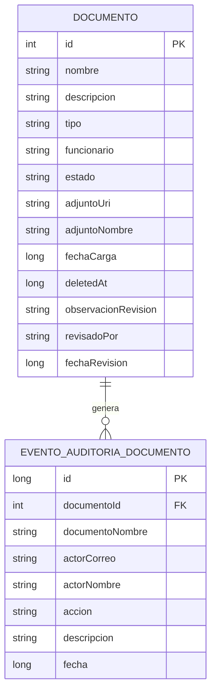
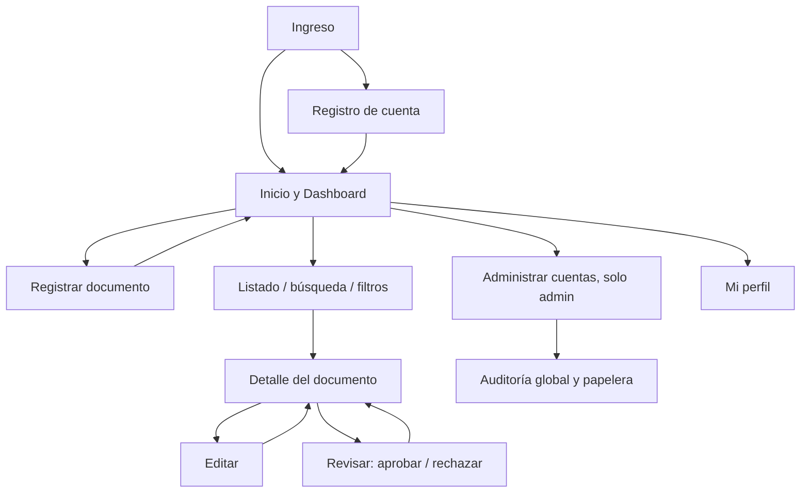

# Modelo de datos y navegación — CMQ Salud v1.6

## Modelo local preliminar

**Advertencia técnica:** `documentoId` es una relación lógica, sin constraint `FOREIGN KEY` de SQLite en esta versión, porque se conserva el historial incluso tras la purga definitiva del documento. `actorCorreo` es una referencia a una cuenta local, no una relación SQL: las cuentas demo están en SharedPreferences. No representa todavía un modelo institucional normalizado de usuarios.

## Mapa de navegación

El rol `FUNCIONARIO` no ve la revisión ni administración. Además de ocultar controles, la revisión valida el rol en `DocumentoRepository`.

**Pendiente de validación:** La funcionalidad de revisar, los estados Aprobado/Rechazado y la reapertura a Pendiente son decisiones explícitas del prototipo, no reglas proporcionadas por CMQ Salud en el enunciado.
